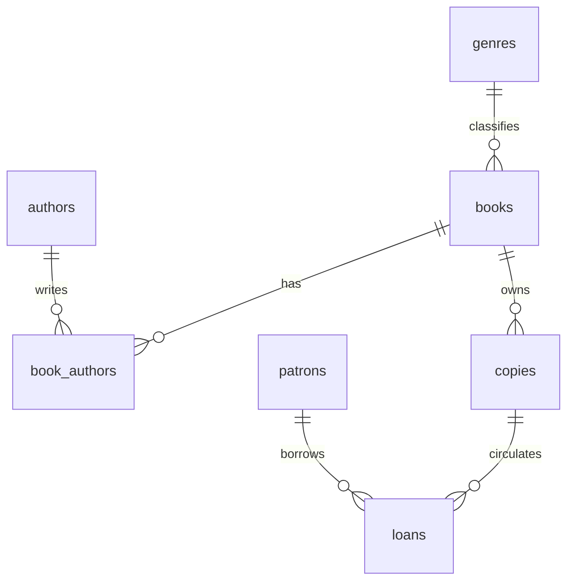

# City Library: From Database Coursework to Reliable Inventory Reporting

SQL case study extending a 2021 college library database project. The question: **Can recorded inventory availability be trusted, and how can the design make future reporting more reliable?**

## Finding

**9 of 31 physical copies (29.0%) were marked rented without an open loan recorded.** Eight had a recorded returned loan; one had no loan history. This is a conflict between records, not proof of missing books or a verified operational error. The historical coursework sample may contain stale flags or incomplete loan history.

The analysis uses all recorded physical copies as its denominator, including checked-out copies. One title can own several copies; counts of titles and copies answer different questions.

## Run

Python 3.9+; no third-party packages or database server needed. From this folder:

```console
python verify_original.py
python run_project.py
```

The first command reproduces the coursework finding. The second builds `library.db`, runs six SQL reports and validation checks, and refreshes [demonstration results](results/demonstration-results.md). SQL dialect: SQLite. The generated database is excluded from version control.

## Analytical Process

1. Translate the original business requirements into availability and loan-history questions.
2. Identify table grain: a catalog title, a physical copy, and a loan are separate entities.
3. Aggregate open loans by copy before joining, preserving one row per copy.
4. Compare recorded loan status with the original availability flags using ordered `CASE` rules.
5. Reconcile row counts and calculate the flagged share of total inventory.
6. Design a separate normalized demonstration and enforce key integrity rules.
7. Validate the reports and document limits before making recommendations.

## Two Separate Datasets

**Historical evidence:** `evidence/coursework-records.json` contains only copy identifiers, book codes, flags, and loan identifiers/dates extracted from the original MySQL export. Patron names, contact information, order-to-patron links, and the full dump are excluded. The source export was completed April 25, 2021; loan dates in the extract span 2018-2019. The extract is historical evidence, not a current inventory snapshot.

**Synthetic demonstration:** `sample_data.sql` contains invented titles and patrons with a fixed reporting date of October 13, 2026. It demonstrates the revised design and reports. It is not a migration of the original data, and its results do not imply a measured improvement to the original library.

## Design Changes

| Original design | Revised demonstration | Reason |
| --- | --- | --- |
| Books and authors refer back to one another | `book_authors` junction | Supports multiple authors and books without circular ownership |
| Genre tied back to individual books | Genre lookup referenced by books | Reuses classifications |
| Stored title count plus copy records | Counts calculated from copies | Avoids competing inventory totals |
| Independent rented/in-library flags | Status derived from open loans plus physical condition | Reduces duplicated status logic |
| Text costs | Integer cents with nonnegative constraint | Supports exact money arithmetic |
| Multiple open loans possible | Unique partial index per copy | Rejects simultaneous open loans |



## Reports

| SQL | Question | Grain |
| --- | --- | --- |
| `01_title_availability.sql` | Which titles have borrowable copies, including zero-stock titles? | Title |
| `02_overdue_loans.sql` | Which recorded open loans are overdue on the reporting date? | Loan |
| `03_genre_inventory.sql` | How is stock and availability distributed across genres? | Genre |
| `04_borrowing_history.sql` | What happened to each recorded loan? | Loan |
| `05_status_summary.sql` | How many copies are available, borrowed, lost, or under repair? | Status |
| `06_quality_checks.sql` | Are there open loans on non-serviceable copies or future checkouts? | Exception |

## Decisions and Limits

Investigate the nine historical discrepancies before changing records. Do not infer availability from a missing open loan alone. In the demonstration, an available copy must be serviceable and have no recorded open loan. An open loan on a non-serviceable copy is labeled for review.

Dates are date-only, not timestamp/timezone measurements. A loan due on the reporting date is not overdue until the next day. The overdue report uses the fixed snapshot date; it is not a general historical reconstruction. A unique open-loan index prevents simultaneous open loans but does not reject overlaps between closed historical loans. Physical condition can change during a loan; the view flags the conflict rather than silently treating the copy as available.

Fees, payments, reservations, staff roles, and production access control are outside this focused iteration. No claim is made about financial savings, real borrower behavior, or missing inventory.

## Provenance and Assistance

Built from the author's original library coursework, business case, and query views. The source files remain unchanged outside this package. This extension was developed with AI assistance for implementation, documentation, and verification, with business rules reviewed through guided SQL exercises.
